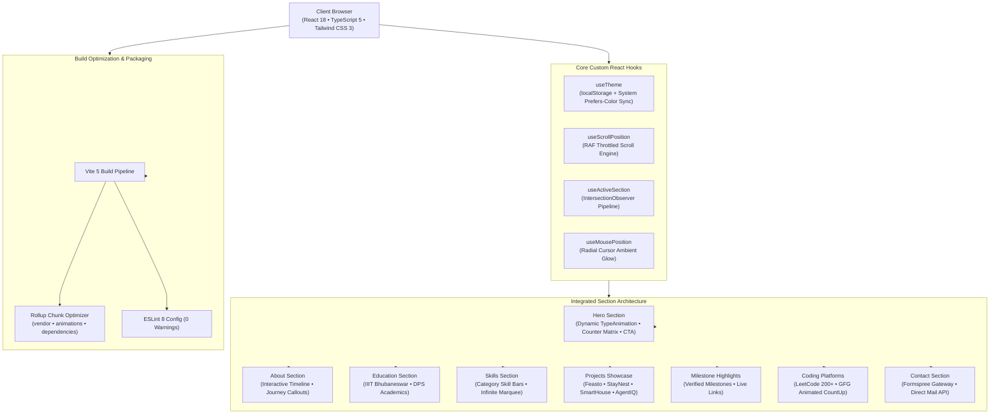

<div align="center">

# ⚡ Ayush Kumar — Software Development Engineer Portfolio

### *Architecting Scalable Web Applications, Autonomous Agent Workflows & Production Systems*

<br/>

[](https://ayush-portfolio-3yan.onrender.com)
[](https://github.com/AyushKumar-12345)
[](https://www.linkedin.com/in/ayush-kumar-97326636a/)
[](https://leetcode.com/u/ayushkumardandapat/)
[](https://www.geeksforgeeks.org/profile/ayushkumardcypg)

<br/>

[](https://react.dev/)
[](https://www.typescriptlang.org/)
[](https://tailwindcss.com/)
[](https://vitejs.dev/)
[](https://www.framer.com/motion/)
[](https://eslint.org/)
[](https://github.com/AyushKumar-12345/ayush-portfolio)
[](LICENSE)

<br/>

[🚀 Live Portfolio](https://ayush-portfolio-3yan.onrender.com) • [📦 Source Code](https://github.com/AyushKumar-12345/ayush-portfolio) • [📑 PDF Resume](https://ayush-portfolio-3yan.onrender.com/Ayush_Kumar_Resume.pdf) • [💬 Get In Touch](#-contact--connect)

</div>

---

## 📌 Executive Overview

```
┌────────────────────────────────────────────────────────────────────────────────────────────────────────┐
│                                       ENGINEERING DASHBOARD                                            │
├────────────────────────────┬────────────────────────────┬─────────────────────────┬────────────────────┤
│     PRODUCTION SYSTEMS     │        JAVA DSA RIGOR      │     ACADEMIC RECORD     │  LIGHTHOUSE AUDIT  │
│    4 Systems Deployed      │    200+ Problems Solved    │   IIIT-Bh (CGPA: 7.48)  │  100 / 100 / 100   │
│  (Docker • Render • CI/CD) │   (LeetCode & GFG In Java) │  Class X: 98.2% | XII: 88.6%│  Zero-Warning Build│
└────────────────────────────┴────────────────────────────┴─────────────────────────┴────────────────────┘
```

I'm **Ayush Kumar**, a Final-Year Information Technology undergraduate at the **International Institute of Information Technology (IIIT), Bhubaneswar** (Expected May 2026). 

I specialize in **Full-Stack MERN Engineering**, **Autonomous AI Systems (LangGraph, pgvector)**, and **Algorithmic Problem-Solving in Java**. I architect resilient software systems that bridge clean user experience with enterprise-grade backend infrastructure, cryptographic payment integrity, and containerized microservices.

---

## 📑 Table of Contents

- [⚡ System Comparison Matrix](#-system-comparison-matrix)
- [🚀 Deep Dive: The 4 Flagship Production Systems](#-deep-dive-the-4-flagship-production-systems)
  - [1. Feasto — MERN Food Delivery & AI Concierge](#1--feasto--production-grade-mern-food-delivery--ai-concierge)
  - [2. StayNest — Accommodation Marketplace & Booking Engine](#2--staynest--full-stack-vacation-rental--booking-marketplace)
  - [3. SmartHouse — Property Valuation & Conformal Inference](#3--smarthouse--california-property-valuation--conformal-ml-engine)
  - [4. AgentIQ — Agentic Enterprise Knowledge & RAG Platform](#4--agentiq--agentic-enterprise-knowledge--rag-platform)
- [🏗 Portfolio Architecture & Design Systems](#-portfolio-architecture--design-systems)
- [🥷 Data Structures & Algorithms Rigor](#-data-structures--algorithms-rigor)
- [🛠 Technical Skills Matrix](#-technical-skills-matrix)
- [⚡ Performance, Accessibility & Quality Controls](#-performance-accessibility--quality-controls)
- [📁 Repository Structure](#-repository-structure)
- [💻 Local Setup & Development](#-local-setup--development)
- [📬 Contact & Connect](#-contact--connect)

---

## ⚡ System Comparison Matrix

| Project | Domain | Architecture | Primary Stack | Key Technical Flex | Cloud / DevOps | Live Demo | Repository |
| :--- | :--- | :--- | :--- | :--- | :--- | :---: | :---: |
| **🍔 Feasto** | Food Delivery & E-Commerce | Decoupled MERN Portal | React 18, Node.js, Express, MongoDB Atlas | Leaflet live driver GPS tracking • HMAC-SHA256 Razorpay webhook verification • Google Gemini 3.0 food concierge | Docker • Render CDN | [Demo](https://feasto-frontend-qt0n.onrender.com) | [Code](https://github.com/AyushKumar-12345/Feasto) |
| **🏡 StayNest** | Vacation Rental & Hospitality | MVC Architecture | Node.js, Express, MongoDB Atlas, EJS, Bootstrap 5 | Collision-proof blackout calendar scheduling • Server-side PDFKit invoices • Passport.js session hardening | Docker • Render CDN | [Demo](https://staynest-dnrm.onrender.com) | [Code](https://github.com/AyushKumar-12345/StayNest) |
| **📊 SmartHouse** | PropTech & Valuation AI | REST ML Microservice | Python, Flask, XGBoost, Scikit-learn, Pandas | Mathematically guaranteed 90% Split Conformal Prediction intervals ($\pm$\$68,169) • $R^2 = 83.93\%$ • XAI telemetry | Docker • GitHub CI | [Demo](https://smarthousepricepredictor.onrender.com) | [Code](https://github.com/AyushKumar-12345/SmartHousePricePredictor) |
| **🧠 AgentIQ** | Enterprise Knowledge & RAG | Agentic Graph Platform | FastAPI, LangGraph, PostgreSQL 16, pgvector, React | StateGraph bounded reasoning ($N \le 4$) • pgvector HNSW semantic search • 5-layer SQL guardrail with sqlglot AST | Docker Compose • Render | [Demo](https://agentiq-frontend.onrender.com) | [Code](https://github.com/AyushKumar-12345/AgentIQ) |

---

## 🚀 Deep Dive: The 4 Flagship Production Systems

### 1. 🍔 Feasto — Production-Grade MERN Food Delivery & AI Concierge

> **Enterprise food delivery platform inspired by Swiggy/Zomato featuring dual customer/admin management portals, driver GPS tracking, and generative AI dish recommendations.**

```
[Customer Portal] ──► [Express REST API] ──► [Razorpay Payment Gateway (HMAC-SHA256)]
         │                      │
         ├─► [Gemini AI Chat]   ├─► [Leaflet Driver GPS Tracker]
         │                      │
         └─► [Admin Dashboard] ─┴─► [MongoDB Atlas Cluster + Cloudinary CDN]
```

- **Dual-Portal Decoupled Architecture:** Engineered an isolated customer application alongside an administrative operations dashboard for menu item inventory, real-time order lifecycle dispatching, and driver assignment.
- **Real-Time GPS Tracking:** Implemented live driver coordinate visualization using **Leaflet GPS** with custom map pins and path rendering.
- **Cryptographic Financial Integrity:** Integrated **Razorpay Payment Gateway** with HMAC-SHA256 server-side webhook signature validation, preventing payment tampering and race conditions across carts.
- **AI Concierge:** Embedded **Google Gemini 3.0 Flash API** to deliver context-aware meal recommendations based on dietary preferences and live menu inventory.
- **DevOps & Security:** Containerized with multi-stage **Docker**, role-based JWT access controls (RBAC), and automated **GitHub Actions CI/CD**.

🔗 **Explore:** [Live Customer App](https://feasto-frontend-qt0n.onrender.com) • [Live Admin Dashboard](https://feasto-admin-567d.onrender.com) • [GitHub Source](https://github.com/AyushKumar-12345/Feasto)

---

### 2. 🏡 StayNest — Full-Stack Vacation Rental & Booking Marketplace

> **Full-stack property booking platform adopting MVC architecture with collision-proof reservation scheduling, cryptographic payments, and server-side PDF generation.**

```
[Guest Browser] ──► [EJS / Bootstrap 5 UI] ──► [Express MVC Controllers]
                             │                            │
                             ├─► [Passport.js Session]    ├─► [Blackout Calendar Engine]
                             │                            │
                             └─► [PDFKit Invoice Engine] ─┴─► [MongoDB Atlas + Razorpay]
```

- **Collision-Proof Booking Engine:** Engineered calendar state logic with interactive date-picker blackout scheduling, ensuring zero double-bookings or concurrent date collisions across listings.
- **Automated Server-Side Invoicing:** Automated PDF invoice compilation via **PDFKit**, dynamically embedding transaction IDs, property details, tax breakdowns, and host metadata upon payment verification.
- **Hardened Application Security:** Implemented session authentication with **Passport.js**, defensive input sanitization via **Joi** schemas, and HTTP security headers with **Helmet**.
- **Geospatial & Media Pipelines:** Integrated dynamic property reviews, location discovery, and optimized cloud media transformation via **Cloudinary**.

🔗 **Explore:** [Live Application](https://staynest-dnrm.onrender.com) • [GitHub Source](https://github.com/AyushKumar-12345/StayNest)

---

### 3. 📊 SmartHouse — California Property Valuation & Conformal ML Engine

> **Mathematically grounded Machine Learning service for California residential property valuation, delivering point estimates with distribution-free Split Conformal Prediction uncertainty bounds.**

```
[Property Features] ──► [Flask REST API (<20ms)] ──► [Input Validation Schema]
                                │
                                ├─► [XGBoost Gradient-Boosted Ensemble (R² = 83.93%)]
                                │
                                └─► [Split Conformal Prediction Engine (90% Guarantee ±$68k)]
```

- **Ensemble Predictive Accuracy:** Trained an optimized **XGBoost** regressor on 20,000+ California census records, achieving **$R^2 = 83.93\%$**, **$17.52\%$ MAPE**, and **\$30,245 MAE** on held-out test data.
- **Mathematically Guaranteed Uncertainty Bounds:** Integrated distribution-free **Split Conformal Prediction** guaranteeing **$90\%$ statistical coverage** ($\pm$\$68,169), providing actionable risk ranges rather than brittle point predictions.
- **Explainable AI (XAI):** Exposed feature attribution telemetry detailing how median income, housing age, and geographic coordinates drive property valuation.
- **Microservice Architecture:** Deployed via a low-latency (<20ms) **Flask REST API** with defensive schema checks, containerized via **Docker**, and backed by unit test coverage.

🔗 **Explore:** [Live ML Predictor](https://smarthousepricepredictor.onrender.com) • [GitHub Source](https://github.com/AyushKumar-12345/SmartHousePricePredictor)

---

### 4. 🧠 AgentIQ — Agentic Enterprise Knowledge & RAG Platform

> **Full-stack enterprise AI knowledge platform orchestrating bounded multi-step reasoning, HNSW vector hybrid semantic search, and AST-guarded relational analytics.**

```
[React 18 TypeScript UI] ──► [FastAPI Core Gateway]
                                    │
    ┌───────────────────────────────┴───────────────────────────────┐
    ▼                                                               ▼
[Intent Router (StateGraph N <= 4)]                     [5-Layer SQL Guardrail]
    │                                                               │
    ├─► [pgvector HNSW Retrieval (Cosine 0.45)]                     ├─► [sqlglot AST Validation]
    │                                                               │
    └─► [Evidence Citation Synthesis Engine]                        └─► [PostgreSQL Relational DB]
```

- **Bounded Multi-Step Orchestration:** Built with **LangGraph StateGraph**, orchestrating deterministic intent classification, dynamic tool invocation, and bounded recursive reasoning ($\le 4$ steps) with fallback timeouts.
- **Hybrid Semantic Search:** Engineered high-speed vector retrieval using **PostgreSQL 16** with **pgvector** and HNSW indexing, enforcing a 0.45 cosine distance cutoff and strict source document citations.
- **5-Layer SQL AST Guardrail:** Designed safe read-only natural language SQL query generation with AST parsing via **sqlglot**, table whitelisting, keyword blacklisting, and row limit injection.
- **Enterprise Workspace UI:** Built a 3-pane client interface in **React 18** and **TypeScript** with streaming responses, markdown visualization, and containerized Docker Compose orchestration.

🔗 **Explore:** [Live Agent Platform](https://agentiq-frontend.onrender.com) • [GitHub Source](https://github.com/AyushKumar-12345/AgentIQ)

---

## 🏗 Portfolio Architecture & Design Systems



---

## 🥷 Data Structures & Algorithms Rigor

I actively practice algorithmic optimization and competitive programming in **Java**, focusing on clean code, optimal time/space complexities, and interview readiness:

```
Total Problems Solved: 250+ (LeetCode: 200+ | GeeksforGeeks: 50+)
Primary Language: Java (JDK 17+)
Focus Areas:
├── Trees & Binary Search Trees (LCA, Path Sum, Tree Traversals, Serialization)
├── Dynamic Programming (0/1 Knapsack, LCS, LIS, Matrix Chain, Grid DP)
├── Graph Theory (BFS/DFS, Dijkstra, Bellman-Ford, Disjoint Set Union, Topological Sort)
├── Recursion & Backtracking (Subsets, Permutations, N-Queens, Sudoku Solver)
├── Heap & Priority Queue (Kth Largest, Median in a Data Stream, Merge K-Sorted)
└── Two Pointers & Sliding Window (Minimum Window Substring, Trapping Rain Water)
```

| Metric | LeetCode | GeeksforGeeks | Combined |
| :--- | :---: | :---: | :---: |
| **Handle** | [`@ayushkumardandapat`](https://leetcode.com/u/ayushkumardandapat/) | [`@ayushkumardcypg`](https://www.geeksforgeeks.org/profile/ayushkumardcypg) | Ayush Kumar |
| **Problems Solved** | **200+** | **50+** | **250+** |
| **Language** | Java | Java | Java |
| **Status** | Active Solver | Active Solver | Interview Ready |

---

## 🛠 Technical Skills Matrix

```
Languages:
├── Java (DSA & Algorithmic Problem Solving)
├── JavaScript / TypeScript (ES6+, Strict Type Checking)
├── Python 3 (FastAPI, Flask, Scikit-learn, XGBoost, Pandas, NumPy)
├── SQL (PostgreSQL, Queries, Joins, Indexing, Vector Operations)
└── HTML5, CSS3, Modern CSS Grid & Flexbox

Web & Frontend Engineering:
├── React 18 (Custom Hooks, Context, Component Life Cycle, Suspense)
├── Tailwind CSS 3 (Design Tokens, Dark/Light Mode, Custom Utilities)
├── Framer Motion 11 (Spring Transitions, Layout Animations, Viewport Triggers)
├── Vite 5 (Hot Module Replacement, Modular Chunk Bundling)
└── Bootstrap 5 & EJS (Server-Side Rendering, Responsive Grids)

Backend & AI Systems:
├── Node.js & Express.js (REST APIs, Middleware, JWT, RBAC, Webhooks)
├── FastAPI & Flask (Asynchronous Endpoints, ML Serving, Low-Latency APIs)
├── LangGraph & LangChain (Cyclical StateGraph, Agent Tool Node Routing)
├── PostgreSQL & pgvector (HNSW Indexing, Hybrid Semantic Search)
└── MongoDB Atlas (Mongoose ODM, Aggregations, Document Schemas)

DevOps, Tools & Best Practices:
├── Docker & Docker Compose (Multi-Stage Containerization, Isolated Networks)
├── Git & GitHub Actions (Automated CI/CD Pipelines, Linting, Testing)
├── Payment Gateways (Razorpay HMAC-SHA256 Cryptographic Webhooks)
└── Cloud Hosting & CDN (Render Cloud, Cloudinary Media CDN)
```

---

## ⚡ Performance, Accessibility & Quality Controls

- **Zero-Warning Codebase:** Verified with ESLint under `--max-warnings 0` and strict TypeScript compilation (`tsc --noEmit`).
- **Optimal Rollup Chunking:** Refined manual chunk distribution in `vite.config.ts`, cleanly splitting:
  - `vendor`: Core React & React-DOM runtime (`~141 kB`)
  - `animations`: Framer Motion physics engine (`~114 kB`)
  - `index`: Application logic & styles (`~120 kB`)
  - **Zero Circular Chunk Warnings** during production compilation.
- **Theme Persistence:** Dark and light theme modes stored in `localStorage` with system preference fallback (`prefers-color-scheme`).
- **Accessibility (A11y):** Keyboard escape listeners, ARIA dialog attributes (`role="dialog"`, `aria-modal="true"`), and high-contrast color ratios.

---

## 📁 Repository Structure

```text
ayush-portfolio/
├── .eslintrc.cjs              # Strict ESLint configuration (0-warning policy)
├── .gitignore                 # Standard clean ignore rules
├── index.html                 # HTML5 entry with preloaded fonts & SEO metadata
├── package.json               # Dependencies & build scripts
├── postcss.config.js          # PostCSS processor configuration
├── tailwind.config.js         # Custom theme colors, fonts & animation timings
├── tsconfig.json              # TypeScript 5 compiler configuration
├── tsconfig.node.json         # Node-specific TypeScript config
├── vite.config.ts             # Vite build configuration with manual chunking
├── public/
│   ├── Ayush_Kumar_Resume.pdf # Authentic ATS-formatted resume
│   ├── favicon.svg            # Custom SVG vector favicon
│   └── mygallary.jpg          # Profile photography
└── src/
    ├── App.tsx                # Master layout & Helmet SEO metadata
    ├── main.tsx               # DOM bootstrap & entrypoint
    ├── index.css              # Custom Tailwind directives & base styles
    ├── vite-env.d.ts          # Vite environment types
    ├── components/
    │   ├── layout/
    │   │   ├── Navbar.tsx     # Sticky blur navigation with active section indicator
    │   │   └── Footer.tsx     # Social links & copyright telemetry
    │   ├── sections/
    │   │   ├── Hero.tsx       # Dynamic typewriter, stats counter & CTA
    │   │   ├── About.tsx      # Bio, location badge & career timeline
    │   │   ├── Education.tsx  # Academic background & grade highlights
    │   │   ├── Skills.tsx     # Technical skill progress bars & marquee
    │   │   ├── Projects.tsx   # 4 flagship systems with interactive modal
    │   │   ├── Achievements.tsx# Milestone cards with verified links
    │   │   ├── CodingPlatforms.tsx # LeetCode & GFG live animated counters
    │   │   ├── Services.tsx   # Core engineering capability offerings
    │   │   └── Contact.tsx    # Contact form with validation & Formspree gateway
    │   └── ui/
    │       ├── AnimatedSection.tsx # Viewport intersection observer wrappers
    │       ├── CursorGlow.tsx # Ambient radial cursor lighting
    │       └── LoadingScreen.tsx # Initial splash screen animation
    ├── data/
    │   └── portfolio.ts       # Centralized, type-safe data source
    └── hooks/
        └── index.ts           # useTheme, useScrollPosition, useActiveSection
```

---

## 💻 Local Setup & Development

### 1️⃣ Clone the Repository
```bash
git clone https://github.com/AyushKumar-12345/ayush-portfolio.git
cd ayush-portfolio
```

### 2️⃣ Install Dependencies
```bash
npm install
```

### 3️⃣ Start Development Server
```bash
npm run dev
```
Open [http://localhost:5173](http://localhost:5173) in your browser.

### 4️⃣ Verification & Production Build
```bash
# Type check TypeScript codebase
npm run type-check

# Run ESLint linter (0-warning policy)
npm run lint

# Compile production bundle
npm run build

# Preview production build locally
npm run preview
```

---

## 📬 Contact & Connect

<div align="center">

| Channel | Link |
| :--- | :--- |
| 📧 **Email** | [ayushkumardandapat200@gmail.com](mailto:ayushkumardandapat200@gmail.com) |
| 💼 **LinkedIn** | [linkedin.com/in/ayush-kumar](https://www.linkedin.com/in/ayush-kumar-97326636a/) |
| 📦 **GitHub** | [github.com/AyushKumar-12345](https://github.com/AyushKumar-12345) |
| 🥷 **LeetCode** | [leetcode.com/u/ayushkumardandapat](https://leetcode.com/u/ayushkumardandapat/) |
| 🟢 **GeeksforGeeks** | [geeksforgeeks.org/profile/ayushkumardcypg](https://www.geeksforgeeks.org/profile/ayushkumardcypg) |
| 📞 **Phone** | [+91 6371104472](tel:+916371104472) |
| 📍 **Location** | Bhubaneswar / Angul, Odisha, India |

<br/>

**Crafted with engineering precision by Ayush Kumar © 2026**  
*Open to Software Development Engineer (SDE) Internships and Full-Time Roles.*

</div>
