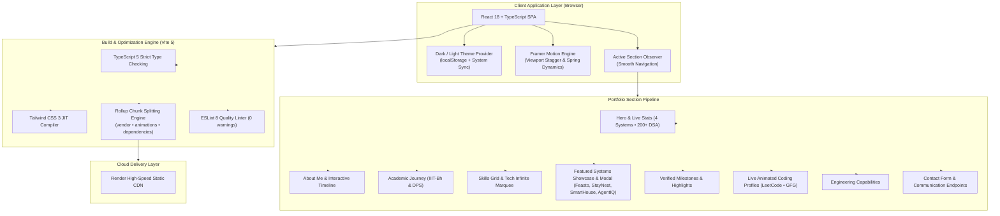

# 🌐 Ayush Kumar — Software Development Engineer Portfolio

<div align="center">

[](https://ayush-portfolio-3yan.onrender.com)
[](https://github.com/AyushKumar-12345)
[](https://www.linkedin.com/in/ayush-kumar-97326636a/)
[](https://leetcode.com/u/ayushkumardandapat/)
[](https://www.geeksforgeeks.org/profile/ayushkumardcypg)

<br/>

[](https://react.dev/)
[](https://www.typescriptlang.org/)
[](https://tailwindcss.com/)
[](https://vitejs.dev/)
[](https://www.framer.com/motion/)
[](https://github.com/AyushKumar-12345/ayush-portfolio)
[](https://eslint.org/)
[](LICENSE)

<br/>

**A modern, production-grade developer portfolio engineered with React 18, TypeScript, Tailwind CSS, and Framer Motion.**  
*Showcasing 4 containerized full-stack systems, 200+ Java Data Structures & Algorithms solutions, and high-performance interactive UI.*

<br/>

[🚀 Explore Live Portfolio](https://ayush-portfolio-3yan.onrender.com) • [📦 GitHub Repository](https://github.com/AyushKumar-12345/ayush-portfolio) • [📑 View Resume](https://ayush-portfolio-3yan.onrender.com/Ayush_Kumar_Resume.pdf) • [📬 Get In Touch](#-connect--contact)

</div>

---

## 👨‍💻 Executive Summary

I'm **Ayush Kumar**, an Information Technology undergraduate student at **IIIT Bhubaneswar** (B.Tech 2023–2027, CGPA: 7.48). I specialize in engineering full-stack web platforms, agentic AI workflows, and scalable backend microservices.

- 🏆 **Algorithmic Rigor:** Solved **200+ Data Structures & Algorithms** problems in **Java** across LeetCode and GeeksforGeeks, focusing on trees, graphs, dynamic programming, and recursion.
- 🚀 **4 Deployed Production Systems:** Architected, containerized, and deployed 4 full-stack platforms with Docker, CI/CD, and cloud hosting on Render.
- 🎯 **Engineering Excellence:** Type-safe architecture, responsive layouts, zero-warning ESLint validation, optimized bundle chunking, and accessible UI.

---

## 🚀 The 4 Flagship Production Systems

```
┌────────────────────────────────────────────────────────────────────────────────────────┐
│                                 PRODUCTION SYSTEMS                                     │
├─────────────────────┬─────────────────────┬─────────────────────┬──────────────────────┤
│      1. FEASTO      │     2. STAYNEST     │    3. SMARTHOUSE    │     4. AGENTIQ       │
│  MERN Food Delivery │  Airbnb-Style Rental│  ML Property Engine │ Agentic AI Platform  │
│  & AI Concierge     │  & Blackout Booking │  & Conformal Bounds │ & Hybrid Vector RAG  │
└─────────────────────┴─────────────────────┴─────────────────────┴──────────────────────┘
```

### 1. 🍔 Feasto — Full-Stack MERN Food Delivery & AI Concierge Platform
- **Architecture:** Decoupled dual-portal MERN architecture (Customer Ordering Portal + Restaurant Admin Dashboard).
- **Key Features:** Live driver delivery GPS tracking via **Leaflet**, cryptographic **Razorpay** payment gateway verification with HMAC-SHA256 signatures, **Google Gemini 3.0** AI food concierge, JWT role-based authentication, and Cloudinary media pipelines.
- **DevOps:** Multi-container **Docker** setup, automated CI/CD pipeline, and deployed on Render.
- **Tech Stack:** React 18, Node.js, Express.js, MongoDB Atlas, Razorpay, Google Gemini AI, Docker, Leaflet.
- **Links:** [🌐 Live Demo](https://feasto-frontend-qt0n.onrender.com) • [📦 GitHub](https://github.com/AyushKumar-12345/Feasto)

---

### 2. 🏡 StayNest — Full-Stack Vacation Rental & Booking Marketplace
- **Architecture:** Full-stack MVC accommodation marketplace inspired by Airbnb.
- **Key Features:** Collision-proof booking engine with interactive blackout calendar scheduling, cryptographic **Razorpay** payment verification, automated server-side PDF invoice generation via **PDFKit**, Passport.js session security, Joi schema validation, and Cloudinary CDN storage.
- **DevOps:** Docker containerization, automated testing, and cloud deployment on Render.
- **Tech Stack:** Node.js, Express.js, MongoDB Atlas, EJS, Bootstrap 5, Razorpay, PDFKit, Cloudinary.
- **Links:** [🌐 Live Demo](https://staynest-dnrm.onrender.com) • [📦 GitHub](https://github.com/AyushKumar-12345/StayNest)

---

### 3. 📊 SmartHouse — California Property Valuation & ML Inference Engine
- **Architecture:** Mathematically grounded Machine Learning inference service for residential property valuation in California.
- **Performance:** Achieved **$R^2 = 83.93\%$** and **$17.52\%$ MAPE** (\$30,245 MAE) using an optimized **XGBoost** gradient-boosted ensemble trained on 20,000+ property records.
- **Key Features:** Integrated distribution-free **Split Conformal Prediction** delivering mathematically guaranteed **90% confidence intervals** ($\pm$\$68,169), eliminating financial tail risk. Explainable AI (**XAI**) feature attribution telemetry and defensive input validation schemas.
- **DevOps:** Low-latency (<20ms) Flask REST API containerized with Docker and GitHub Actions CI.
- **Tech Stack:** Python, Flask, XGBoost, Scikit-learn, Pandas, NumPy, Docker, Split Conformal Prediction.
- **Links:** [🌐 Live Demo](https://smarthousepricepredictor.onrender.com) • [📦 GitHub](https://github.com/AyushKumar-12345/SmartHousePricePredictor)

---

### 4. 🧠 AgentIQ — Agentic Enterprise Knowledge & RAG Platform
- **Architecture:** Full-stack enterprise AI knowledge platform orchestrating bounded multi-step reasoning with deterministic fallbacks and sub-second retrieval.
- **Key Features:** **LangGraph StateGraph** ($N \le 4$ reasoning steps), hybrid semantic search via **PostgreSQL 16** and **pgvector** (HNSW indexing, 0.45 cosine cutoff) with source citations, 5-layer SQL guardrails with **sqlglot AST parsing**, and an enterprise 3-pane React 18 TypeScript workspace.
- **DevOps:** Multi-stage Docker Compose orchestration and automated GitHub Actions CI/CD test suite.
- **Tech Stack:** Python, FastAPI, LangGraph, PostgreSQL 16, pgvector, React 18, TypeScript, Docker Compose.
- **Links:** [🌐 Live Demo](https://agentiq-frontend.onrender.com) • [📦 GitHub](https://github.com/AyushKumar-12345/AgentIQ)

---

## 🏗 Architecture & Engineering Design



---

## 🥷 Algorithmic Problem Solving & Profiles

| Platform | Profile | Problems Solved | Primary Language | Key Topics |
| :--- | :--- | :---: | :---: | :--- |
| **LeetCode** | [@ayushkumardandapat](https://leetcode.com/u/ayushkumardandapat/) | **200+** | **Java** | Trees, Graphs, Dynamic Programming, Recursion, Binary Search |
| **GeeksforGeeks** | [@ayushkumardcypg](https://www.geeksforgeeks.org/profile/ayushkumardcypg) | **50+** | **Java** | Arrays, Hashing, Linked Lists, Greedy Algorithms, Strings |

---

## 💻 Tech Stack & Skills Matrix

```
Frontend:
├── React 18 (Hooks, Suspense, Error Boundaries)
├── TypeScript (Strict Type Safety, Interfaces)
├── Tailwind CSS (Utility-First, Dark Mode)
├── Framer Motion (Spring Physics, Layout Animations)
└── Vite 5 (Sub-second HMR, Rollup Bundling)

Backend & Systems:
├── Node.js & Express.js (REST APIs, JWT Auth)
├── Python & FastAPI / Flask (Microservices, ML Serving)
├── PostgreSQL & pgvector (HNSW Indexing, Vector Search)
├── MongoDB Atlas (Mongoose ODM, Document Schemas)
└── Java (Data Structures & Algorithmic Optimization)

DevOps & Tools:
├── Docker & Docker Compose (Containerization)
├── Git & GitHub Actions (CI/CD Pipelines)
├── Razorpay (Cryptographic HMAC Webhook Signatures)
└── Cloudinary & Render (Media CDN & Production Hosting)
```

---

## 📁 Repository Structure

```text
ayush-portfolio/
├── .eslintrc.cjs              # Strict ESLint configuration (0-warning policy)
├── .gitignore                 # Standard clean ignore rules
├── index.html                 # HTML5 entry with SEO tags & preloaded fonts
├── package.json               # Dependencies & build scripts
├── postcss.config.js          # PostCSS processor configuration
├── tailwind.config.js         # Custom theme colors, fonts & animations
├── tsconfig.json              # TypeScript 5 compiler configuration
├── tsconfig.node.json         # Node-specific TypeScript config
├── vite.config.ts             # Vite build configuration with manual chunking
├── public/
│   ├── Ayush_Kumar_Resume.pdf # Authentic ATS-formatted resume
│   ├── favicon.svg            # Custom SVG vector favicon
│   └── mygallary.jpg          # Profile photography
└── src/
    ├── App.tsx                # Master application layout & Helmet SEO
    ├── main.tsx               # DOM bootstrap & entrypoint
    ├── index.css              # Custom Tailwind directives & base styles
    ├── vite-env.d.ts          # Vite environment types
    ├── components/
    │   ├── layout/
    │   │   ├── Navbar.tsx     # Sticky blur header with active section indicator
    │   │   └── Footer.tsx     # Social links & copyright telemetry
    │   ├── sections/
    │   │   ├── Hero.tsx       # Dynamic typewriter, stats counter & CTA
    │   │   ├── About.tsx      # Bio, location badge & career timeline
    │   │   ├── Education.tsx  # Academic background & grade highlights
    │   │   ├── Skills.tsx     # Technical skill progress bars & marquee
    │   │   ├── Projects.tsx   # 4 flagship systems with interactive modal
    │   │   ├── Achievements.tsx# Milestone cards with verified links
    │   │   ├── CodingPlatforms.tsx # LeetCode & GFG live animated counters
    │   │   ├── Services.tsx   # Core engineering capability offerings
    │   │   └── Contact.tsx    # Formspree contact form with validation
    │   └── ui/
    │       ├── AnimatedSection.tsx # Viewport intersection observer wrappers
    │       ├── CursorGlow.tsx # Ambient radial cursor lighting
    │       └── LoadingScreen.tsx # Elegant initial splash screen
    ├── data/
    │   └── portfolio.ts       # Centralized, type-safe data source
    └── hooks/
        └── index.ts           # useTheme, useScrollPosition, useActiveSection
```

---

## ⚡ Performance & Quality Controls

- **Optimized Bundle Splitting:** Refined Rollup `manualChunks` in `vite.config.ts` isolating core React libraries, Framer Motion, and application logic with **zero circular chunk dependencies**.
- **Type Safety:** 100% type coverage with strict TypeScript verification (`npm run type-check`).
- **Code Hygiene:** Verified with ESLint under `--max-warnings 0`.
- **Responsive Layout:** Engineered for fluid scaling across mobile (320px+), tablet, desktop, and ultra-wide screens.
- **Accessibility:** Semantic HTML elements, keyboard-accessible modals with Escape listener, and ARIA labels.

---

## 🛠 Local Setup & Development

### 1️⃣ Prerequisites
- **Node.js:** v18.0.0 or higher
- **npm:** v9.0.0 or higher

### 2️⃣ Clone Repository
```bash
git clone https://github.com/AyushKumar-12345/ayush-portfolio.git
cd ayush-portfolio
```

### 3️⃣ Install Dependencies
```bash
npm install
```

### 4️⃣ Start Development Server
```bash
npm run dev
```
Open [http://localhost:5173](http://localhost:5173) in your browser.

### 5️⃣ Code Quality & Type Checks
```bash
# Type check TypeScript codebase
npm run type-check

# Run ESLint linter
npm run lint

# Build for production
npm run build

# Preview production build locally
npm run preview
```

---

## 📬 Connect & Contact

- **Name:** Ayush Kumar
- **Institution:** International Institute of Information Technology (IIIT), Bhubaneswar
- **Email:** [ayushkumardandapat200@gmail.com](mailto:ayushkumardandapat200@gmail.com)
- **Phone:** +91 6371104472
- **Location:** Bhubaneswar / Angul, Odisha, India
- **LinkedIn:** [linkedin.com/in/ayush-kumar](https://www.linkedin.com/in/ayush-kumar-97326636a/)
- **GitHub:** [github.com/AyushKumar-12345](https://github.com/AyushKumar-12345)
- **LeetCode:** [leetcode.com/u/ayushkumardandapat](https://leetcode.com/u/ayushkumardandapat/)
- **GeeksforGeeks:** [geeksforgeeks.org/profile/ayushkumardcypg](https://www.geeksforgeeks.org/profile/ayushkumardcypg)

---

<div align="center">

**Built with precision by Ayush Kumar © 2026**  
*Available for SDE Internships and Full-Time Roles.*

</div>
